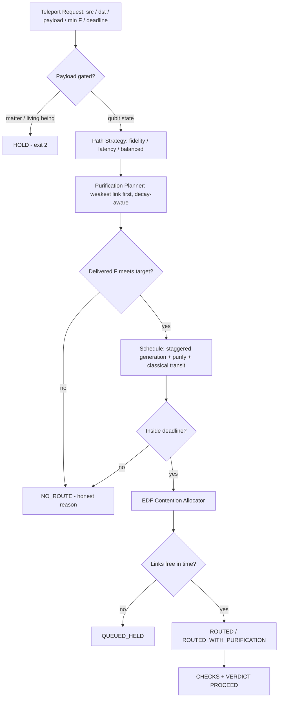
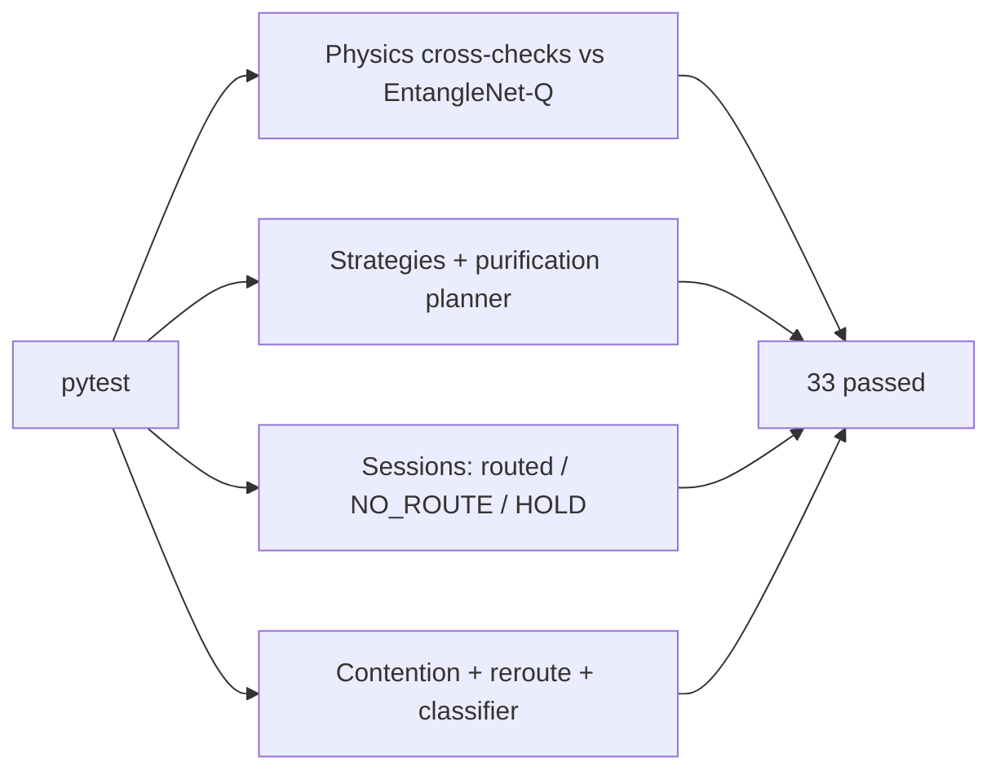
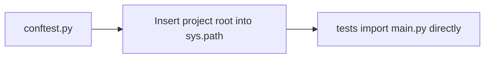
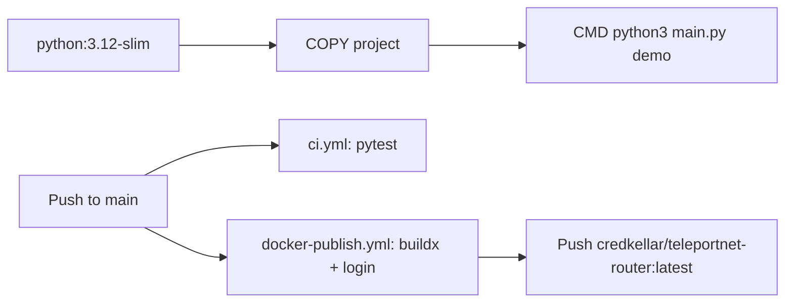

# TeleportNet-Router 🛰️⚛️

**Teleportation Network Routing Lab** — by Darion Kellar

TeleportNet-Router is an **educational teleportation routing lab** in ONE pure-Python file. It is the **application / routing layer** of Darion's quantum network stack, and it is deliberately *not* a repeat of the layers below it:

- **TeleportX** = the teleportation **protocol** (one hop, one Bell pair). 🌀
- **EntangleNet-Q** = the **physics layer**: what a link, a swap, a purification round, and a memory wait can and cannot do. 🔗
- **TeleportNet-Router** = the **routing layer**: what a network *operator* decides, session by session. 🛰️

A **teleport request** arrives — source, destination, payload, minimum fidelity, deadline — and the router must **route it, schedule its purification, fit it inside its deadline, share links fairly with other sessions, survive a link failure — or honestly refuse it** (`NO_ROUTE` / `HOLD`, with the reason printed). Every physics formula it plans with is the one simulation-verified in EntangleNet-Q (Werner product rule, DEJMPS map, teleport output `(2F + 1)/3`, memory decay `exp(-t / T2)`), and this lab cross-checks its chain numbers against EntangleNet-Q's published results in its own CHECKS. 🔬

Honest scope, stated up front: no production quantum internet or teleportation service exists. This lab routes **nothing real**: no network, no hardware, no matter, no living beings — and nothing faster than light, because every teleported qubit still pays for its **2 classical bits** at light speed. Every live / product claim sits behind a permanent HOLD gate (14 total). 🔒

[](https://github.com/kimanicollier44-cmyk/TeleportNet-Router/actions/workflows/ci.yml)
[](https://github.com/kimanicollier44-cmyk/TeleportNet-Router/actions/workflows/docker-publish.yml)

> ℹ️ These are the **live** workflow badges for this repo. They activate as soon as the `ci.yml` and `docker-publish.yml` files from the paste pack are pasted into `.github/workflows/` — until then they have nothing to report yet.

## 🧰 Tech Stack Badges & Full Architecture Tech Stack

### 💻 Core Programming Languages & Core Systems


- 🐍 Python 3.12, pure standard library (`math`, `heapq`, `hashlib`, `json`, `sys`) — zero dependencies, zero network, deterministic (double-run byte-identical)
- ⚛️ Quantum core: Werner link model inherited from EntangleNet-Q — `w = q · exp(-d / L)`, `F = (1 + 3w)/4`; swapping product rule, DEJMPS purification map + success probability, teleport output `(2F + 1)/3`, memory T2 decay — formulas sim-verified in EntangleNet-Q, cross-checked here against its published numbers
- 🗺️ Routing engine: three Dijkstra strategies (fidelity / latency / balanced), greedy decay-aware purification planner, EDF session allocator, failure rerouting
- 🧠 TinyML kNN session-feasibility classifier (from scratch, stdlib): feasible / needs-purification / infeasible
- 🪑 Council seats: Gemini Carbon 4 DECIDER (names-only, tighten-only) + Muse advisor (never overrides HOLD) + Google Flow plan-only (rendered = False, live = 0)

### ⛓️ Web3 & Infrastructure

- 🚫 **Not applicable — honestly.** No blockchain, no Web3, no tokens, and no live network of any kind: the "network" in this lab is a labeled simulation graph (Los Angeles / Las Vegas / Phoenix / Albuquerque / Denver / Dallas) inside one offline file. No fake badges here.

### ⚙️ Platform Support & Hardware Architecture


- 🖥️ Pure Python — runs anywhere Python 3.12+ runs (Linux, macOS, Windows), plus the `python:3.12-slim` Docker image
- 🔒 No hardware is controlled, ever: real quantum hardware, repeaters, routers, and satellite links are permanent HOLD gates (see the gate table below)

### ⚡ Low-Level Infrastructure & Performance

- 🚫 **No low-level code — honestly.** No C, no C++, no GPU, no compiled extensions: this is one interpreted Python file on purpose, so every number can be read, checked, and diffed. Performance here means honest algorithms — Dijkstra on `heapq`, a greedy planner, EDF allocation — all deterministic and byte-identical between runs.

### 🛠️ DevOps & Build Tools


- 🐳 Docker (`python:3.12-slim`), GitHub Actions CI + Docker Publish (delivered in the paste pack)
- 🎯 Target image: `credkellar/teleportnet-router:latest`
- 🧪 Tests: `pytest` (33 tests) + the built-in CHECKS suite (47 checks) in `main.py`

### ☁️ Cloud Providers

- 🚫 **None — honestly.** No cloud provider is used or needed: the lab runs fully offline on your own machine or in a local Docker container. Docker Hub appears only as the registry the publish workflow pushes the image to.

## What this does?

1. 📥 **Session model** — a request is `(source, destination, payload spec, minimum pair fidelity, deadline, qubits)`. Payloads of kind `matter` or `living_being` never reach the routing math: they return **HOLD** immediately, by gate.
2. 🗺️ **Three path strategies** — on the same labeled sim graph as EntangleNet-Q (Los Angeles / Las Vegas / Phoenix / Albuquerque / Denver / Dallas): **fidelity** (Dijkstra on −ln w), **latency** (expected generation + transit time), and **balanced** (fidelity cost + schedule time priced in memory-decay units). Los Angeles → Dallas: fidelity picks Las Vegas → Phoenix → Dallas (pair F = 0.5022, schedule 0.7217 s); latency takes the 2-hop legacy-fiber shortcut (0.7200 s) but delivers pair F = 0.3868 — a teleport fidelity of 0.5912, **below the 0.6667 classical limit**; balanced sides with fidelity.
3. ✨ **Purification scheduling** — a greedy planner adds DEJMPS rounds to the currently weakest link until the session target is met — planned against the **delivered** fidelity (fresh minus memory decay during the rounds), not the paper number. For the Dallas session (target 0.55) it schedules **4 rounds on Phoenix–Dallas only**, costing an expected **85.4 raw pairs** and 0.0568 s to deliver F = 0.5680.
4. ⏳ **Memory-time budgeting** — generation starts are **staggered** so pairs finish together (the routing-layer fix for the naive-schedule decay EntangleNet-Q measured: 0.5022 → 0.3463); pairs then only decay during the purification phase, and that decay is charged before any promise is made. A session whose schedule misses its deadline, or whose delivered fidelity misses its target, gets **NO_ROUTE with the reason** — e.g. target 0.55 in 0.05 s, or target 0.99 at any deadline inside the round cap.
5. 🚦 **Multi-session contention** — links carry one session chain at a time; admission is **earliest-deadline-first**. Of three competing sessions: Phoenix routes at t = 0, Dallas queues behind it on the shared links and still makes its 1.2 s deadline (finish 1.023 s), and Las Vegas → Dallas — perfectly feasible alone — is **QUEUED_HELD** because queueing would push its finish to 1.743 s, past its 1.4 s deadline. The fairness rule is stated in code, not vibes.
6. 💥 **Failure handling** — when the Phoenix–Dallas link drops mid-plan, the session replans over Los Angeles → Las Vegas → Phoenix → Albuquerque → Dallas (2,638 km instead of 2,335 km), reschedules purification, and **survives** at F ≥ 0.55 with ~56.3 expected pairs.
7. 📞 **Classical channel accounting** — every teleported qubit is charged **2 classical bits**, and the schedule includes their one-way light time along the path (2,335 km → a 0.0117 s floor inside the 0.7785 s Dallas schedule). Nothing in this lab is faster than light, and the floor is asserted in CHECKS.
8. 🏷️ **Feasibility classifier** — a from-scratch kNN labels proposed sessions `feasible` / `needs-purification` / `infeasible` from distance + target + deadline features.
9. 🧠 **Advisory seats + checks** — Carbon 4 DECIDER with sha256 trace, Muse advisor, Google Flow plan-only, and a built-in CHECKS suite (47 checks).

## 🗺️ How it works — diagram per script

### `main.py` — the whole lab



### `tests/test_main.py` — verification



### `conftest.py` — test path setup



### `Dockerfile` + CI flow — container & publish



## Why is this cool?

1. 🛰️ It completes the operator's view of the quantum stack — TeleportX is the protocol, EntangleNet-Q is the physics, this is the **control room**.
2. 🗺️ The latency strategy *loses on purpose*: its shortcut delivers teleport fidelity 0.5912, **below the classical limit** — the lab shows why "fastest" is the wrong default.
3. ✨ Purification is planned against **delivered** fidelity, not fresh — the planner pays the memory-decay tax before promising anything.
4. ⏳ Staggered generation is a real routing-layer win: it erases the wait-decay that cost EntangleNet-Q's naive chain 0.5022 → 0.3463.
5. 🚦 Contention is handled with a stated fairness rule (EDF) and an honest QUEUED_HELD — no silent degradation, no favoritism.
6. 💥 The failure demo doesn't just reroute — it replans purification on the detour and prints the new pair cost.
7. 🚫 Refusals are first-class output: NO_ROUTE comes with the *reason* (deadline, unreachable fidelity), and gated payloads HOLD before any math.
8. 📞 The classical channel is in the schedule, in the budget, and in the checks — the anti-FTL line is arithmetic, not a disclaimer.
9. 🧮 Dijkstra three ways, a greedy planner, EDF allocation, and a kNN — all stdlib `math` and `heapq`. No numpy, no networkx, anywhere.
10. 🎯 Deterministic end to end: run it twice, get byte-identical output — a router you can diff.

## What problems this solves?

1. ❌ **Problem:** Quantum-network demos teleport over perfect pairs on empty networks. ✅ **Solution:** Sessions here carry fidelity targets and deadlines, share links, and can be refused.
2. ❌ **Problem:** Routing demos pick one metric (usually hops) and never show the trade-off. ✅ **Solution:** Three strategies run on the same graph and their delivered fidelity *and* schedule are printed side by side.
3. ❌ **Problem:** Purification is quoted as a fidelity number without cost. ✅ **Solution:** Every plan prices itself in expected raw pairs and seconds before it is accepted.
4. ❌ **Problem:** Plans are made against fresh-pair fidelity that memory decay then destroys. ✅ **Solution:** The planner targets delivered fidelity after decay — and staggered starts remove the generation-wait decay entirely.
5. ❌ **Problem:** "It'll probably be fine" scheduling. ✅ **Solution:** Generation + purification + classical transit are summed and compared to the deadline; misses are NO_ROUTE, in writing.
6. ❌ **Problem:** Shared-resource contention is ignored until production. ✅ **Solution:** A capacity model + EDF admission shows exactly who waits, who makes it, and who gets held — and why.
7. ❌ **Problem:** Failure handling is an afterthought in sim labs. ✅ **Solution:** A dropped link triggers a full replan (path + purification + cost) in the demo and the tests.
8. ❌ **Problem:** Teleportation gets marketed as instant / FTL. ✅ **Solution:** 2 classical bits per qubit are charged at light speed in every schedule, and `claim_ftl_communication` is a permanent HOLD gate.
9. ❌ **Problem:** Session feasibility gets guessed by gut. ✅ **Solution:** A kNN classifier gives a first-pass feasible / needs-purification / infeasible label from the three numbers that matter.
10. ❌ **Problem:** Simulation tools quietly imply a service is next. ✅ **Solution:** 14 named HOLD gates return exit code 2 for every live-operation or production claim, forever.

## How to install this?

1. 📋 Clone or download this project folder.
2. 🐍 Make sure Python 3.12+ is installed: `python3 --version`
3. ▶️ Run the full demo + checks (no arguments needed):

```bash
python3 main.py
```

4. 🧪 Run the test suite:

```bash
pip install pytest
python3 -m pytest -q
```

5. 🎛️ Try the other commands:

```bash
python3 main.py checks      # 47 built-in checks
python3 main.py strategies  # fidelity vs latency vs balanced, LA -> Dallas
python3 main.py plan        # all demo sessions routed / refused / held
python3 main.py purify      # purification plan for the Dallas session
python3 main.py contention  # EDF allocation of three competing sessions
python3 main.py reroute     # Phoenix-Dallas link drops: the replan
python3 main.py classify    # kNN session feasibility report
python3 main.py brains      # Carbon 4 + Muse + Flow seats
python3 main.py holds       # list all 14 HOLD gates
python3 main.py hold-demo   # exits 2 - gated claims stay HOLD
```

6. 🐳 Or run it in Docker:

```bash
docker build -t credkellar/teleportnet-router:latest .
docker run --rm credkellar/teleportnet-router:latest
```

## Requirements

- 🐍 Python 3.12 or newer
- 📦 Dependencies: **none** (standard library only)
- 🌐 Network: **none** — fully offline
- 🧪 For tests only: `pytest`
- 🐳 Optional: Docker

## FULL project structure tree

```text
teleportnet-router/
├── main.py                  # the whole lab: physics layer, 3 strategies, purification planner, sessions, contention, reroute, classifier, seats, HOLD gates
├── conftest.py              # puts the project root on sys.path for tests
├── tests/
│   └── test_main.py         # 33 pytest tests: cross-checks, strategies, sessions, contention, reroute, gates, determinism
├── assets/
│   └── cover.png            # README cover image (2736 x 912)
├── Dockerfile               # python:3.12-slim, runs the demo
├── .gitignore               # __pycache__/, .pytest_cache/, *.pyc
└── README.md                # this file
```

> 📦 Delivered separately as paste packs (not in this tree): `.github/workflows/ci.yml` + `docker-publish.yml`, and the Docker Hub pack (100-char description, 350-char About, overview, categories).

## 🔒 HOLD gates — all 14, permanent

| # | Gate | What stays held |
|---|------|-----------------|
| 1 | `live_network_operation` | No operating any real quantum or classical network, ever |
| 2 | `real_hardware_control` | No control of any real quantum hardware, repeater, or router |
| 3 | `claim_ftl_communication` | Entanglement never sends information faster than light; teleportation needs a classical channel |
| 4 | `claim_production_service` | No production teleportation service exists; this is a simulation lab |
| 5 | `teleport_matter_claim` | No teleporting matter; only quantum states of simulated qubits are routed |
| 6 | `teleport_living_being_claim` | No teleporting living beings, ever |
| 7 | `live_qkd_key_use` | No generating or using real cryptographic keys for real traffic |
| 8 | `commercial_service_claim` | No commercial routing / teleportation service is offered or implied |
| 9 | `bypass_no_cloning_claim` | The no-cloning theorem is not bypassed; teleportation destroys the original state |
| 10 | `guaranteed_fidelity_claim` | Fidelities here are model estimates under labeled assumptions, never guarantees |
| 11 | `live_satellite_link` | No commanding or tasking any real satellite link |
| 12 | `real_fiber_deployment` | No instructions for deploying or splicing live carrier fiber plant |
| 13 | `intercept_traffic_claim` | No intercepting, decrypting, or monitoring anyone's real traffic |
| 14 | `medical_data_transport_claim` | No claims about transporting real medical or personal data |

🧑‍⚖️ **Council seats:** Gemini Carbon 4 Extended Thinking — DECIDER (names-only, tighten-only, MAP → MODEL → STRESS → DECIDE, sha256 trace, `can_override_hold = False`) · Muse — advisor (`can_override_hold = False`) · Google Flow — plan-only (`rendered = False`, `live = 0`).

✅ **Verification:** pytest **33 passed** (project + clean copy) · built-in CHECKS **47/47** · double-run output **byte-identical** · `hold-demo` exits **2** · `main.py` **901 lines**, pure stdlib, zero network.

---

MIT © 2026 Darion Kellar · TeleportNet-Router — educational simulation only 🛰️
